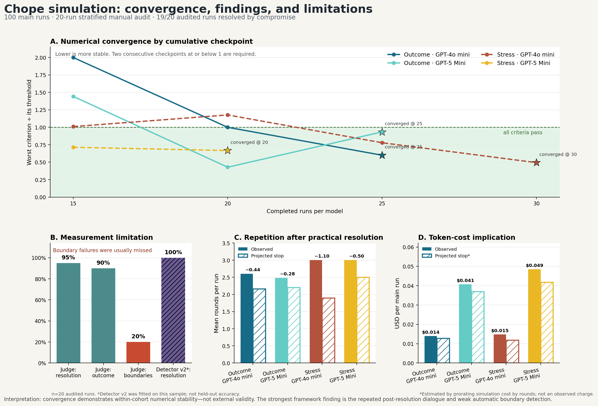

# Chope combined audit report

This report compares the saved outcome-mode and fixed-horizon stress cohorts after the same audited detector-v2 rules were applied offline.

## Dashboard

## Main results

| Mode | Model | Runs | Detector resolution | Mean actual rounds | Mean projected stop round | Actual cost | Projected cost* | Converged |
|---|---|---:|---:|---:|---:|---:|---:|:---:|
| outcome | openai/gpt-4o-mini | 25 | 52.0% | 2.60 | 2.16 | $0.348902 | $0.318992 | yes (25) |
| outcome | openai/gpt-5-mini | 25 | 76.0% | 2.48 | 2.20 | $1.018321 | $0.923613 | yes (25) |
| stress | openai/gpt-4o-mini | 30 | 56.7% | 3.00 | 1.90 | $0.443751 | $0.353647 | yes (30) |
| stress | openai/gpt-5-mini | 20 | 60.0% | 3.00 | 2.50 | $0.970098 | $0.835731 | yes (20) |

Main completed runs only; pilot costs are excluded from this table.

## Manual audit

| Sample | Reviewed | Judge resolution | Judge outcome | Judge boundary events | Detector-v2 resolution | Detector-v2 outcome |
|---|---:|---:|---:|---:|---:|---:|
| outcome | 10 | 100.0% | 100.0% | 40.0% | 100.0% | 100.0% |
| stress | 10 | 90.0% | 80.0% | 0.0% | 100.0% | 100.0% |
| combined | 20 | 95.0% | 90.0% | 20.0% | 100.0% | 100.0% |

## What the audit supports

- In the audited sample, 19 of 20 runs resolved through concession/accommodation (`compromise`), not consensus; one stress run remained unresolved.
- Fixed-horizon runs often continue with generic agreement after the practical issue is already settled; those extra turns add cost and repetition, not much new scenario evidence.
- The structured judge is strong on whether resolution occurred, but less reliable on outcome taxonomy and especially weak at flagging repetitive or corrupted dialogue as boundary failures.
- Use outcome stopping for the showcase. Keep a smaller fixed-horizon cohort as a boundary test demonstrating post-resolution repetition.

## Guardrails

- The two cohorts are independent samples, not paired runs with matched random seeds.
- *Projected cost is estimated by prorating simulation cost by rounds; it is not an observed OpenRouter charge.
- Recomputed convergence still uses the original saved transcript embeddings.
- A 20% audit sample is diagnostic rather than a definitive error-rate estimate.
- Detector v2 was calibrated from this audit sample, so its 100% sample agreement is in-sample fit, not independent validation. Validate it on fresh held-out runs before making a general accuracy claim.
